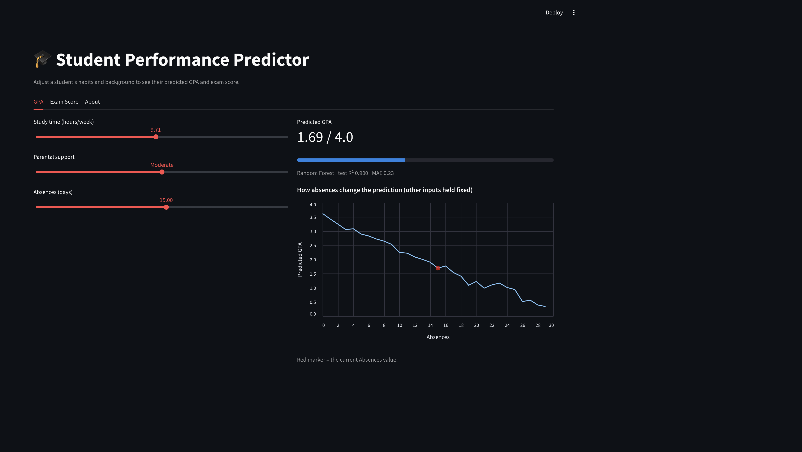
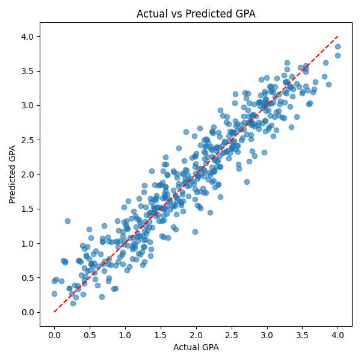

# 🎓 Student Performance Predictor

**Predicting student GPA and exam scores from study habits, attendance, and family background, with an interactive web app.**

[](https://arshdeep-gpa-predictor.streamlit.app)


### 👉 [Try the live demo](https://arshdeep-gpa-predictor.streamlit.app)



Move the sliders to change a student's study time, absences, attendance, motivation, and so on. The app updates the predicted GPA and exam score instantly and charts how the prediction changes as one factor varies.

---

## Key findings

- **Absences matter far more than study time for GPA.** Absences correlate with GPA at −0.92. With other inputs held fixed, going from 0 to 25 absences drops the predicted GPA from **3.62 to 0.94**. Study time (+0.18) and parental support (+0.19) have much weaker effects.
- **Attendance and study hours drive exam scores.** In permutation importance they rank far above prior scores, tutoring, motivation, and income. In a linear model, each extra 10 percentage points of attendance adds about **2 exam points**, and each extra weekly study hour adds about **0.3 points**.
- **Simpler models won.** Plain linear regression slightly outperformed both Random Forest and Gradient Boosting, which suggests the relationships in this data are mostly linear. I kept the tree models in the app because they don't assume linearity, but the comparison is reported honestly below.
- **Sleep has almost no predictive value** for exam scores in this dataset (permutation importance ≈ 0).

## Results

Evaluated on a held-out 20% test split. A "predict the average" baseline is included for reference.

| Target | Model | Test R² | Test MAE | 5-fold CV R² |
|---|---|---|---|---|
| GPA (0–4) | Predict the mean (baseline) | 0.00 | 0.77 | – |
| | Linear Regression | **0.918** | **0.20** | – |
| | Random Forest (used in app) | 0.900 | 0.23 | 0.89 |
| Exam score | Predict the mean (baseline) | 0.00 | 2.82 | – |
| | Linear Regression | **0.700** | **1.01** | – |
| | Gradient Boosting (used in app) | 0.667 | 1.17 | 0.63 |

In practice, the GPA model is off by about **0.2 GPA points** on average.

<p align="center">
  
</p>

## What's in the project

- **Data cleaning and encoding** of three raw Kaggle datasets: academic behaviour (2,392 students), student profiles (6,607 students), and socioeconomic scores.
- **Regression models** for GPA (Random Forest) and exam score (Linear Regression vs. Histogram Gradient Boosting), with cross-validation and permutation feature importance.
- **Unsupervised clustering** of student behaviour profiles with K-Means, visualised with PCA.
- **Batch prediction CLI** that scores a CSV of new students.
- **Interactive Streamlit app** that trains the models on startup and serves live predictions.
- **Written report** ([`report.pdf`](report.pdf)) covering data overview, statistical tests, model evaluation, and cluster profiles.

## Tech stack

Python · pandas · NumPy · scikit-learn · Streamlit · Altair · Matplotlib · seaborn

## Run it locally

```bash
git clone https://github.com/arshmann2003/student-performance-prediction.git
cd student-performance-prediction
python3 -m venv .venv && source .venv/bin/activate
pip install -r requirements.txt
streamlit run app.py
```

Then open http://localhost:8501.

### Predict GPA for a CSV of new students

```bash
python predict/predict_gpa.py predict/input/new_students.csv
```

The input CSV needs these columns (results are written to `predict/output/predicted_gpa.csv`):

```csv
StudyTimeWeekly,ParentalSupport,Absences
10.5,2,4
5.0,1,10
18.0,3,1
```

## Project structure

```
student-performance-prediction/
├── app.py                    # Streamlit web app
├── data/
│   ├── raw/                  # Original Kaggle datasets
│   └── interim/              # Cleaned datasets used for modeling
├── figures/                  # Plots from EDA and modeling
├── models/                   # Saved trained models
├── notebooks/
│   └── data_exploration.ipynb
├── predict/
│   ├── predict_gpa.py        # Batch GPA prediction from a CSV
│   └── input/                # Example input file
├── scripts/
│   ├── clean_merge.py                  # Cleaning and encoding
│   ├── gpa_random_forest.py            # GPA model
│   ├── modeling_exam_score.py          # Exam score models
│   └── clustering_student_profiles.py  # K-Means clustering
├── pipeline.py               # Runs the scripts end to end
└── report.pdf                # Full written analysis
```

## Limitations

- Both datasets are public Kaggle datasets and are likely synthetic, so these results may not transfer to real students.
- The models capture **correlation, not causation**. Fewer absences predict a higher GPA, but this project doesn't show that reducing absences *causes* higher grades.
- The GPA model uses only three features, chosen so it's simple to use in the app.

## Next steps

- Add SHAP explanations to the app so each prediction shows *why* the model made it.
- Choose the number of clusters with silhouette scores instead of fixing it at three.
- Add unit tests and a GitHub Actions CI workflow.

## Author

**Arshdeep Mann** · Simon Fraser University
[GitHub](https://github.com/arshmann2003)
